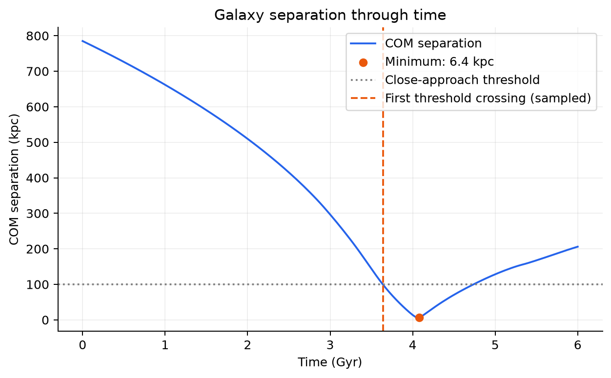
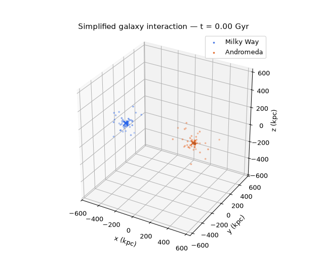
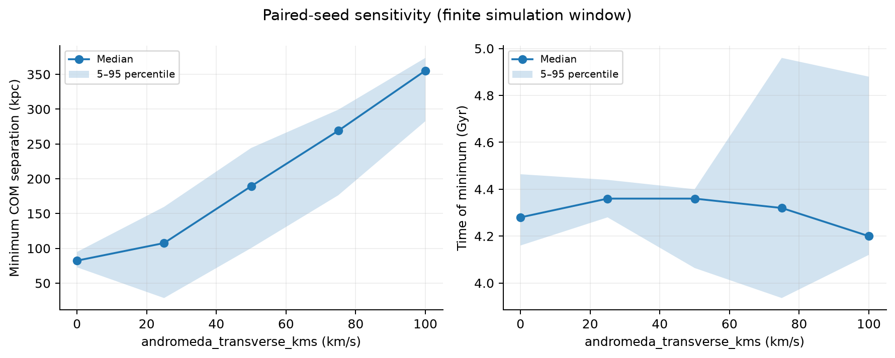
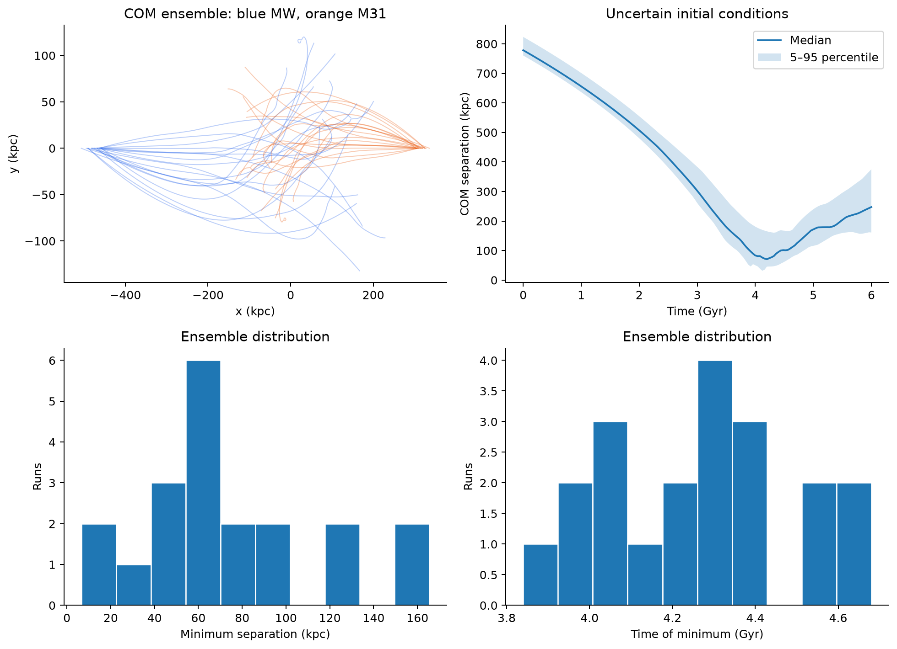
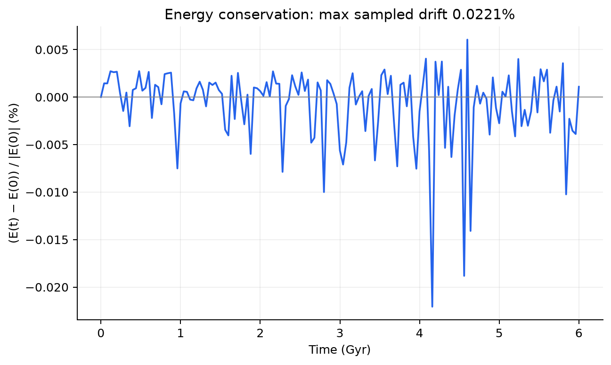
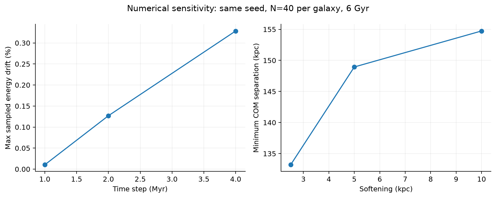
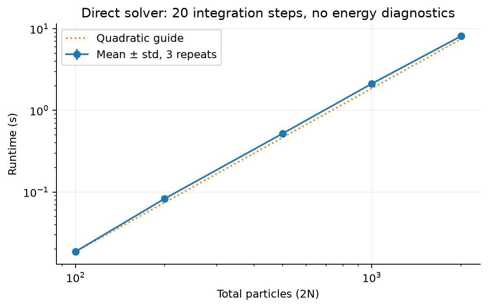

# Milkomeda — interactive galaxy interaction experiments

## Objective
Explore how configurable initial conditions and numerical choices change a
simplified Milky Way–Andromeda gravitational interaction. This is a reproducible
simulation study, **not a prediction of an inevitable collision**.

## Physical model
Particles interact through softened Newtonian gravity:

$$\mathbf a_i=G\sum_{j\ne i}m_j\,
\frac{\mathbf r_j-\mathbf r_i}{(\|\mathbf r_j-\mathbf r_i\|^2+\epsilon^2)^{3/2}}.$$

Softening epsilon regularizes close encounters and changes the resolved force;
it is a model/resolution choice, not a guarantee of accuracy. Units are kpc,
solar masses and years; the interface accepts bulk velocities in km/s.

Each galaxy contains sampled NFW halo, Hernquist bulge and approximate disk-like
components. Total mass includes the sampled dark halo. Component proportions and
relative radii retain the original model. Halo sampling uses enclosed mass, not
density alone. Velocities are approximate rotating initial conditions, **not a
self-consistent equilibrium distribution**. Mass-weighted recentering enforces the
requested initial separation and relative velocity before shifting to the global
barycentric frame.

## Simulation
The existing kick–drift–kick leapfrog integrator and direct/Barnes–Hut force
solvers are reused. Direct forces cost O((2N)^2); auto selects direct up to 3000
total particles and Barnes–Hut above that. This inherited switch is not a measured
hardware-optimal crossover. Barnes–Hut can introduce additional conservation error.

Configuration lives in `src/config.py`; CLI, Streamlit and ensembles share one
engine. The initial state and final step are always saved, including when steps
is not divisible by the sampling stride. COM membership stays tied to each
galaxy's original particles even after mixing.

## Parameters
| Parameter / CLI option | Meaning | Unit |
|---|---|---|
| initial-distance-kpc | Initial MW–M31 COM distance | kpc |
| andromeda-radial-kms | Relative radial velocity; negative approaches | km/s |
| andromeda-transverse-kms | Relative signed transverse velocity | km/s |
| mw-mass / m31-mass | Total component mass of each galaxy | solar masses |
| mw-radius-kpc / m31-radius-kpc | Halo scale radius; scales other component radii | kpc |
| mw-inclination-deg / m31-inclination-deg | Rotation about x | degrees |
| dispersion | Random velocity dispersion / circular speed | fraction |
| N | Particles **per galaxy**, total = 2N | — |
| dt / steps / duration-gyr | Timestep / steps / optional duration override | yr / — / Gyr |
| softening / theta | Force smoothing / BH opening angle | kpc / — |
| sample-every / frame-every | Diagnostic stride / animation snapshot stride | steps / snapshots |
| seed / method | Reproducible draw / direct, bh or auto | — |

Presets: `current_estimate`, `head_on`, `high_transverse`, `low_transverse`,
`high_mass_andromeda`, `high_mass_milky_way`. Names denote illustrative scenarios.
In particular, **current_estimate is an inherited demonstration baseline, not an
updated observational estimate**. Explicit CLI flags override a loaded config,
which overrides the preset. Duration overrides steps and must be divisible by dt.

## Run
Python 3.12:
```bash
python -m venv .venv
# Windows: .venv\Scripts\activate
python -m pip install -r requirements.txt
python simulate.py --preset current_estimate --N 80 --validate --animate
python simulate.py --preset high_transverse --andromeda-transverse-kms 70 --output results/runs/custom/simulation.h5
python simulate.py --help
python -m src.experiments
python -m pytest -q
```

A run saves HDF5 trajectories, masses, COM diagnostics and energy, plus adjacent
config/metrics/provenance JSON (seed, dependency versions, Git revision and source
hashes). HDF5 particle arrays are float64; `src.simulation.load_summary` reads only
COM and validation arrays. Large HDF5/NPZ outputs are ignored by Git and recreated
by the commands. Old incompatible outputs are archived locally in ignored
`legacy/`; they do not support current claims.

## Interactive exploration
```bash
streamlit run streamlit_app.py
```
Load a preset, edit physical/numerical controls, then press **Run simulation**.
Editing controls alone does not launch work. Runs receive separate directories.
Inspect units-labeled metrics and snapshots, or select two or more saved scenarios
to overlay separation curves and compare their metrics without loading all particles.




## Sensitivity and uncertainty
```bash
python sweep_transverse_velocity.py --N 40 --vtrans-min 0 --vtrans-max 100 --vtrans-count 5 --runs-per-v 5
python sweep_transverse_velocity.py --parameter softening --minimum 2.5 --maximum 10 --count 4 --N 40
python simulate_100_center_trajectories.py --N 40 --runs 20 --distributions results/uncertainty_distributions.json
```
The generic sweep also accepts initial distance, M31 mass and radial velocity.
Particle seeds are paired across parameter values. Without a distributions file,
Monte Carlo varies particle sampling only. A JSON maps parameters to Gaussian
`mean` and `std`; invalid positive-parameter draws fail rather than being clipped.

The executed uncertainty experiment draws signed transverse velocity from
Normal(17, 20²) km/s and distance from Normal(785, 25²) kpc, with 20 particle seeds.
These **user-configurable toy distributions are not observational uncertainties**.
Bands are ensemble 5–95 percentiles, not confidence intervals or collision probabilities.
All closest approaches are minima within the simulated interval.




## Results
Generated by `python -m src.experiments`: two 6 Gyr runs, N=80 per galaxy,
dt=2 Myr, softening=5 kpc, seed=42; 25 sweep runs and 20 uncertainty runs use N=40.
Six numerical checks preserve the 6 Gyr duration. Runtime profiling uses
N=50,100,250,500,1000 per galaxy, 20 steps and three repeats, with energy disabled.

<!-- RESULTS:START -->
| Scenario | Minimum (kpc) | Time (Gyr) | Final (kpc) | Max energy drift (%) |
|---|---:|---:|---:|---:|
| current_estimate | 6.42 | 4.08 | 206.01 | 0.0221 |
| high_transverse | 169.54 | 4.92 | 218.05 | 0.0194 |
<!-- RESULTS:END -->

The table describes particular particle realizations. At N=40 with the same
baseline seed, the minimum is 148.94 kpc; at N=80 it is 6.42 kpc. This is a
large resolution/sampling dependence, **not evidence of physical convergence**.
The 20-run uncertainty ensemble has median minimum 67.16 kpc, with 5–95
percentiles 19.99–159.31 kpc (within this toy experiment).

## Numerical validation
Energy uses the same softened pair potential as the forces. Saved diagnostics:
signed (E(t)−E(0))/|E(0)|, maximum absolute drift, linear momentum and global COM
deviation from its expected uniform motion. Momentum change is normalized by
sum(m_i |v_i(0)|), since initial total momentum is almost zero in this frame.
Maxima and threshold crossings are sampled, not continuous-time bounds.
`--no-validate` skips expensive direct energy diagnostics and records null, not zero.

In the fixed-seed N=40 timestep check, maximum energy drift is 0.0103%, 0.1270%
and 0.3285% for dt=1,2,4 Myr. Better energy conservation alone does not validate
the galaxy model. The representative direct run has relative momentum drift
below 1e−14 and global COM drift below 1e−9 kpc.





## Limitations
- Extremely coarse galaxies and simplified sampled dark matter; no gas,
  hydrodynamics, star formation, cosmological environment or other Local Group bodies.
- Approximate, non-equilibrium initial velocities can cause internal relaxation;
  softening and particle noise materially affect encounters.
- Small ensembles and a limited timestep study are not a convergence proof.
  A threshold crossing is not a merger, and labeled-particle COM is not a bound-core tracker.
- Barnes–Hut is approximate; the reported long runs use direct forces.
- No quantitative agreement with reference astrophysical simulations is claimed.
  The Milky Way's future is not determined by these illustrative runs.
